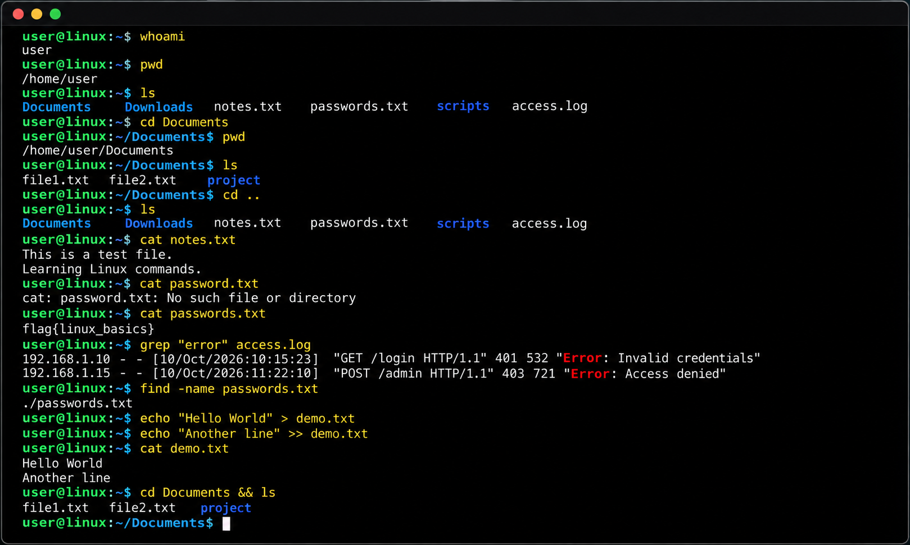

# Linux Fundamentals Part 1

**Keenan McGriff · Linux command-line foundations · Hands-on training**

A concise record of my Linux Fundamentals Part 1 practice: navigating the filesystem, inspecting files, searching logs, using shell operators, and troubleshooting command errors.

## Skills demonstrated

- Identify the current user and working directory.
- Navigate directories and read files from the terminal.
- Locate files by name and search file contents.
- Inspect an access log for matching requests.
- Chain commands, run a command in the background, and redirect output.
- Diagnose a filename mismatch by checking the directory and exact spelling.

## Command tutorial illustration



*User-provided command tutorial illustration. This image illustrates the commands discussed below; it does not show TryHackMe room completion.*

## Command reference

| Command | Purpose | Example |
| --- | --- | --- |
| `whoami` | Show the current username | `whoami` |
| `echo` | Print text | `echo "Linux practice"` |
| `pwd` | Show the current directory's absolute path | `pwd` |
| `ls` | List directory contents | `ls -la` |
| `cd` | Change directory | `cd ..` |
| `cat` | Display a text file | `cat notes.txt` |
| `find` | Locate files in a directory tree | `find . -type f -name "passwords.txt"` |
| `grep` | Find matching lines in text | `grep -n "GET" access.log` |

## Practical workflows

The commands below are illustrative examples based on my lab notes. Paths and search values should be adjusted to the files in the current environment.

### 1. Orient, navigate, and read

```bash
whoami
pwd
ls
cd Documents
pwd
ls -la
cat notes.txt
cd ..
```

- Check the current directory before assuming where a file is stored.
- Use `cd ..` to move to the parent directory.
- Confirm the destination with `pwd` and inspect available files with `ls`.

### 2. Locate a file

```bash
find . -type f -name "passwords.txt"
```

- `.` starts the search in the current directory.
- `-type f` limits results to regular files.
- `-name` matches the filename; spelling and capitalization matter.
- Use the returned path with `cat` to read the intended file.

### 3. Search an access log

```bash
cat access.log
grep -n "GET" access.log
grep -nF "192.0.2.10" access.log
grep -c "GET" access.log
```

- Inspect the log's format, then narrow the search to relevant lines.
- `-n` adds line numbers for reference.
- `-F` treats the example IP address as literal text.
- `-c` counts matching lines, which is not necessarily the number of occurrences or unique visitors.
- A matching request is an investigation lead; it does not by itself establish malicious activity.

### 4. Redirect and append output

```bash
echo "Linux Fundamentals Part 1" > lab-notes.txt
echo "Practiced navigation and log searching." >> lab-notes.txt
grep -n "GET" access.log > matching-requests.txt
cat lab-notes.txt
cat matching-requests.txt
```

- `>` creates a file or overwrites its existing contents.
- `>>` creates a file or appends to its existing contents.
- Check the destination filename before redirecting output to avoid overwriting useful notes.
- These operators redirect standard output; error messages require separate handling.

## Shell operators

| Operator | Behavior | Example |
| --- | --- | --- |
| `&` | Run a command in the background; the shell can accept another command | `sleep 5 &` |
| `&&` | Run the next command only if the previous command succeeds | `cd Documents && ls` |
| `>` | Write standard output to a file, replacing existing contents | `echo "First note" > notes.txt` |
| `>>` | Append standard output to a file | `echo "Next note" >> notes.txt` |

A background command can still write to the terminal. With `&&`, success is determined by the command's exit status.

## Troubleshooting: password.txt vs. passwords.txt

**Issue:** A command referenced `password.txt`, while the intended file was `passwords.txt`.

**Troubleshooting workflow:**

```bash
pwd
ls -la
find . -type f -name "password*.txt"
cat passwords.txt
```

- Verify the working directory.
- Compare the exact filename, including the extra `s`, capitalization, and extension.
- If the file is in a subdirectory, read it using the path returned by `find`.
- Use tab completion where available to reduce typing errors.

**Lesson learned:** A “No such file or directory” error is a prompt to verify the path and filename before changing permissions or assuming a system problem.

## Lessons learned

- Establish context first: user, working directory, then available files.
- Separate finding a file (`find`) from searching its contents (`grep`).
- Narrow log searches to a specific question and review the surrounding context.
- Choose overwrite or append deliberately when saving output.
- Small spelling differences can explain a failed command; verify simple causes first.

## Room completion and evidence

- **Training:** TryHackMe — Linux Fundamentals Part 1.
- **Completion:** Reported complete in my learning notes.
- **Screenshot evidence:** Pending upload of the original completion screenshot.

The original completion image is not yet available in this repository. No substitute image is presented as proof of completion.

---

[Back to portfolio](../../README.md)
